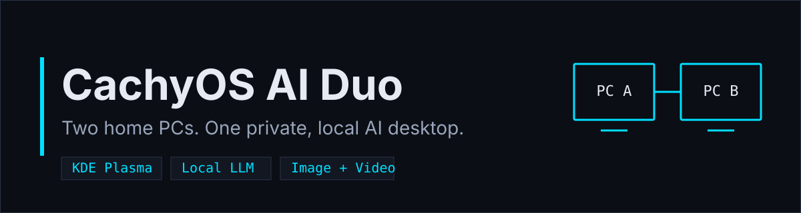

<p align="center">
  
</p>

<p align="center">
  <a href="https://github.com/maxxxcv/cachyos-ai-duo/actions"></a>
  
  
  
</p>

A dark, sharp CachyOS desktop for browsing and local AI, set up to work as a pair of home PCs connected by a network cable.
No telemetry. Everything runs on your own machines.

> **Honest status:** the files pass automated structure checks (CI). Nothing here has been run on real hardware yet.
> Image and video generation are not finished. See the table below.

<div dir="rtl">

## בעברית

שולחן עבודה כהה וחד על בסיס CachyOS, לגלישה ולבינה מלאכותית מקומית, שמחבר שני מחשבים ביתיים בכבל רשת.
בלי טלמטריה, והכול רץ על המחשבים שלך.
ההוראות המלאות להתקנה: [INSTALL.he.md](INSTALL.he.md).
**סטטוס כן:** הקבצים עוברים בדיקות מבנה אוטומטיות, אבל עדיין לא הורצו על חומרה אמיתית. יצירת תמונות ווידאו עוד לא גמורה.

</div>

## Install

1. Write the CachyOS ISO to a USB stick and boot from it ([guide, Hebrew](INSTALL.he.md)).
2. Install CachyOS with KDE Plasma.
3. In a terminal:

```bash
git clone https://github.com/maxxxcv/cachyos-ai-duo.git
cd cachyos-ai-duo
bash install.sh a     # on the i7-8700 PC
bash install.sh b     # on the second PC (also serves AI models to A)
```

## What you get

| Area | What it does | Status |
|---|---|---|
| Desktop look | Dark, sharp theme for KDE, Qt (Kvantum), GTK, login screen (SDDM) and boot splash (Plymouth), built from one set of design tokens | Built, structure-checked, not seen on a real screen |
| Browsing | Firefox with hardware video decoding, no telemetry, uBlock Origin, Hebrew fonts | Prepared, not run |
| Two-PC link | Names the PCs `pc-a` and `pc-b`, finds them over the cable with no IP setup, firewall on wired links only | Prepared, not run |
| Chat and code | Ollama and the opencode agent, models `qwen2.5-coder:7b` and `qwen3:8b`, local only | Prepared, not run |
| Assistant ("Jarvis") | OpenClaw installed from npm, using the local Ollama models; Telegram optional via onboarding; email, calendar, browser and voice are opt-in | Prepared, not run |
| Model switching | `aimodel use <profile>` switches the assistant and code agent between models, and between this PC and the other | Prepared, not run |
| Images | Planned (stable-diffusion.cpp) | Not built |
| Video | Wan 2.2 5B via stable-diffusion.cpp on both PCs | In progress: one tiny test clip made on CPU (256x256, 9 frames, about 5 minutes); Vulkan failed; split across two PCs not done |

## Repository map

| Path | Purpose |
|---|---|
| `install.sh` | One command that runs every step below |
| `twopc/` | `setup-pair.sh`, `pair-status.sh`: discovery, firewall, link test |
| `desktop/` | Browser policy, fonts, power, theme installer |
| `ai/` | Local AI stack and remote worker, see [ai/README.md](ai/README.md) |
| `design-tokens.json/.css`, `design-brief.md` | Single source of truth for the look |
| `build_*.py`, `kde/`, `themes/` | Generated KDE, Kvantum, GTK, SDDM and Plymouth themes |
| `tests/`, `.github/workflows/ci.yml` | Contrast, structure and shell checks on every push |
| `write_usb.ps1` | Guarded ISO writer for Windows (Administrator) |

## Known limits

- On CPU and integrated graphics, LLMs run at a few tokens per second (not measured here), and video will be slow and low resolution.
- Ollama cannot split one model across two PCs. The faster PC serves whole models to the other.
- Plymouth needs a manual initramfs and kernel-parameter step that depends on the bootloader.
- Kvantum themes are derived from KvFlat (GPL-3). Keep that license if you redistribute them.
- The CachyOS ISO is not included; download it from the official mirror and verify its sha256.

## Contributing

Run the checks with `python -m unittest discover -s tests -v`. Reports from real hardware are the most useful contribution.
